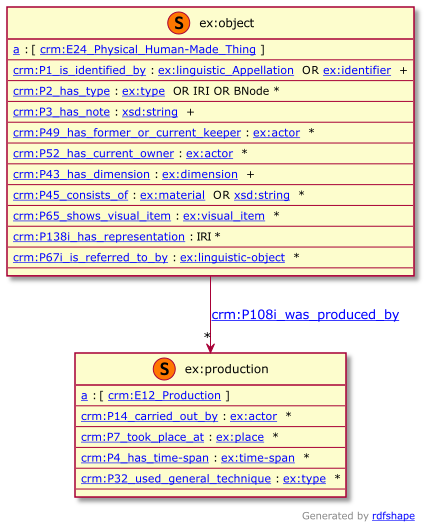
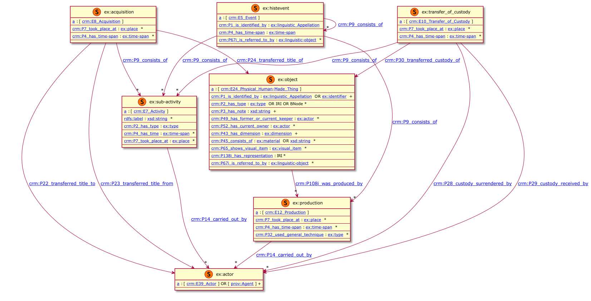
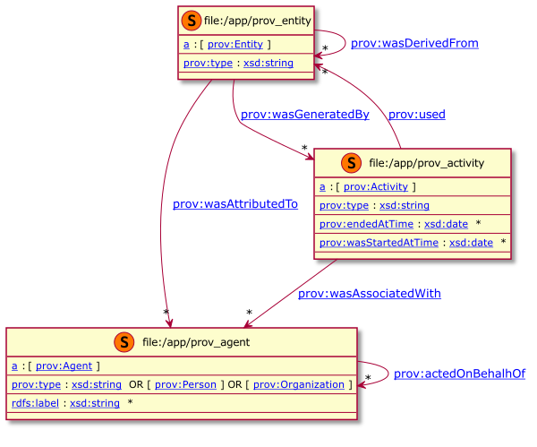
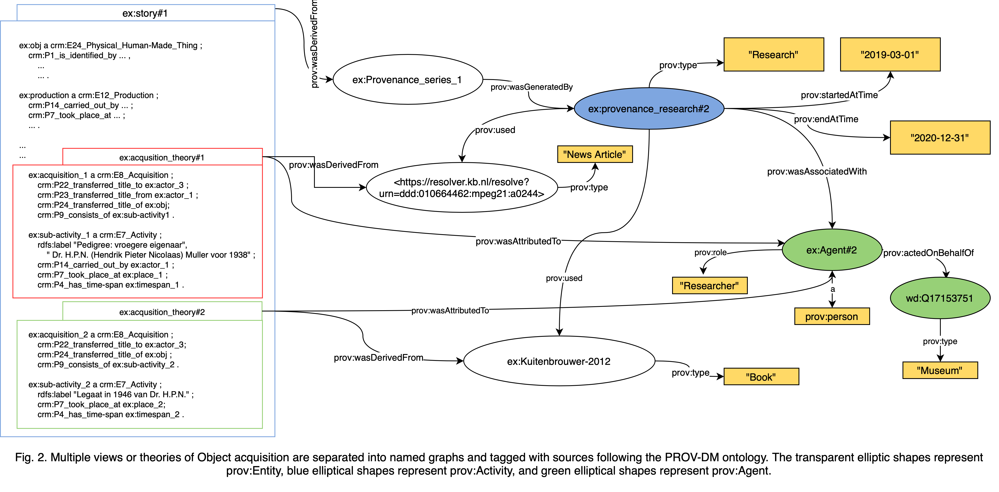

# Polyvocal Knowledge Modelling for Ethnographic Heritage Object Provenance

Supporting data, shapes and queries for a data model that represents the provenance of ethnographic museum objects in RDF, including competing accounts of how an object was acquired.

Provenance research usually ends up in narrative reports, and museum collection systems tend to reduce it to a single version of events. This model keeps each interpretation separate and traceable to its source. It combines three existing standards:

| Component | Role in the model |
| --- | --- |
| [CIDOC-CRM](https://www.cidoc-crm.org/) | Describes objects and the events in their biographies, such as production and changes of custody. |
| [RDF named graphs](https://dl.acm.org/doi/10.1145/1060745.1060835) | Group the statements(triples) that belong to one view or one source, so conflicting claims can coexist. |
| [PROV-DM / PROV-O](https://www.w3.org/TR/prov-o/) | Records where each named graph came from: its sources, its research activity and the responsible agents. |

The model is described in the [SEMANTiCS 2023 paper](https://doi.org/10.3233/SSW230010). Requirements came from interviews with five provenance experts, and the model was tested on 11 objects drawn from exisiting provenance reports.

## Repository contents

| Path | Contents |
| --- | --- |
| [`construct/`](construct/) | TriG files for the six objects used to design the model, with class and property statistics. |
| [`evaluation/`](evaluation/) | TriG files for the five unseen test objects, their provenance reports (PDF), and class & property statistics. |
| [`validator.shex`](validator.shex) | ShEx shapes for the data model. |
| [`shapemap_query.txt`](shapemap_query.txt) | Shape maps that select which nodes to validate against each shape. |
| [`validation_sparql.txt`](validation_sparql.txt) | SPARQL queries for the competency questions. |
| [`ontologies/`](ontologies/) | Local copies of CIDOC-CRM v7.1.2 and PROV-O. |
| [`resource/`](resource/) | [Interview guide](resource/interview_guide.pdf), [competency question table](resource/Table-2.pdf) and model diagrams. |

## The data

Each TriG file describes one object. Its **named graphs** hold the CIDOC-CRM statements, and its **default graph** holds the PROV statements about those named graphs.

| Set | File | Inventory no. | Object | Triples | Named graphs |
| --- | --- | --- | --- | ---: | ---: |
| Construct | `rv-1148-1_provenance.trig` | RV-1148-1 | Decorated elephant tusk | 209 | 3 |
| Construct | `rv-2334-1_provenance.trig` | RV-2334-1 | Bodhisattva head | 249 | 4 |
| Construct | `rv-2334-2_provenance.trig` | RV-2334-2 | Bodhisattva head | 249 | 4 |
| Construct | `rv-2334-3_provenance.trig` | RV-2334-3 | Bodhisattva head | 252 | 4 |
| Construct | `rv-2334-4_provenance.trig` | RV-2334-4 | Bodhisattva head | 248 | 4 |
| Construct | `rv-2584-169a_provenance.trig` | RV-2584-169a | Ox-wagon model | 579 | 5 |
| Evaluation | `obj1.trig` | RV-360-1623 | Shield | 258 | 6 |
| Evaluation | `obj2.trig` | RV-360-5255 | Wayang bèbèr scroll | 344 | 6 |
| Evaluation | `obj3.trig` | RV-360-5839 | Lance | 240 | 6 |
| Evaluation | `obj4.trig` | TM-H-1669 | Curved sabre with scabbard | 152 | 2 |
| Evaluation | `obj5.trig` | RV-3600-193 | Ceremonial kris | 301 | 4 |


## Querying the data

Load the TriG files into any SPARQL 1.1 store that supports named graphs. Most queries combine patterns across graphs, so configure the store to treat the default graph as the union of all graphs.

With Python, using [rdflib](https://rdflib.readthedocs.io/) (`pip install rdflib`), run this from the repository root. It lists the separate acquisition views recorded for the ox-wagon model, RV-2584-169a, with each view's source and author:

```python
from glob import glob
from rdflib import Dataset

ds = Dataset(default_union=True)
for path in glob("construct/*.trig") + glob("evaluation/obj*.trig"):
    ds.parse(path, format="trig")

query = """
PREFIX crm: <http://www.cidoc-crm.org/cidoc-crm/>
PREFIX prov: <http://www.w3.org/ns/prov#>
PREFIX rdfs: <http://www.w3.org/2000/01/rdf-schema#>

SELECT DISTINCT ?view ?source ?agent WHERE {
  GRAPH ?view {
    ?event crm:P30_transferred_custody_of|crm:P24_transferred_title_of
           <https://hdl.handle.net/20.500.11840/829286>
  }
  OPTIONAL { ?view prov:wasDerivedFrom ?source }
  OPTIONAL { ?view prov:wasAttributedTo/rdfs:label ?agent }
}
"""

for row in ds.query(query):
    print(row.view, row.source, row.agent)
```

To run the queries in `validation_sparql.txt` or `evaluation/stat_SPARQL.txt`, add the `crm:`, `prov:`, `rdfs:` and `xsd:` prefix declarations yourself, because the files omit them. Each file holds several queries, so run them one at a time.

### Competency questions

The experts' requirements were condensed into nine questions. Queries marked A or B in `validation_sparql.txt` are alternative interpretations of the same question.

| ID | Question |
| --- | --- |
| CQ1 | Which persons were involved in the provenance of this object? |
| CQ2 | Which objects were collected by person A? |
| CQ3 | Is there a relationship between person A and person B? |
| CQ4 | Which objects were collected in this geographical location? |
| CQ5 | Which objects were collected during this event? |
| CQ6 | Which objects were collected in this geographical location during this time period? |
| CQ7 | Which source states this statement? |
| CQ8 | Who or which institution conducted this research? |
| CQ9 | Which is the latest version of the provenance research? |

## Validating the data

The shapes were validated with the [RDFShape](https://rdfshape.weso.es/shexValidate) web tool:

1. Provide one TriG file as the data.
2. Provide [`validator.shex`](validator.shex) as the schema.
3. Copy one labelled block from [`shapemap_query.txt`](shapemap_query.txt) as the shape map, for example the "data provenance" block.

## The data model

### Object description



### Object provenance

Changes of ownership are modelled as events. `crm:E8_Acquisition` is used for legally recognised transfers and `crm:E10_Transfer_of_Custody` for all others, such as looting. Typed `crm:E7_Activity` sub-activities state how a transfer happened.



### Data provenance

Each named graph is a `prov:Entity`, linked to the sources it derives from, the activity that generated it and the agents responsible for it.



### Multiple perspectives

Each theory of an object's acquisition or origin goes in its own named graph, tagged with its sources. The model does not rank theories or assign them a degree of certainty.




## Citation

If you use this work, please cite the paper:

> Shoilee, S. B. A., de Boer, V., & van Ossenbruggen, J. (2023). Polyvocal Knowledge Modelling for Ethnographic Heritage Object Provenance. In *Knowledge Graphs: Semantics, Machine Learning, and Languages*. Studies on the Semantic Web. IOS Press. https://doi.org/10.3233/SSW230010

```bibtex
@inproceedings{shoilee2023polyvocal,
  title     = {Polyvocal Knowledge Modelling for Ethnographic Heritage Object Provenance},
  author    = {Shoilee, Sarah Binta Alam and de Boer, Victor and van Ossenbruggen, Jacco},
  booktitle = {Knowledge Graphs: Semantics, Machine Learning, and Languages},
  series    = {Studies on the Semantic Web},
  publisher = {IOS Press},
  year      = {2023},
  doi       = {10.3233/SSW230010}
}
```

Archived releases of this repository are on [Zenodo](https://doi.org/10.5281/zenodo.7437713).

## Acknowledgements

This work was carried out at Vrije Universiteit Amsterdam in the context of the [Pressing Matter](https://pressingmatter.nl/) project, funded by NWO through the Netherlands National Research Agenda (NWA.1292.19.419). It partly extends work with Anne Coos van der Tang Eliasson. The evaluation reports come from the [Pilot Project Provenance Research on Objects of the Colonial Era (PPROCE)](https://www.niod.nl/en/projects/pilotproject-provenance-research-objects-colonial-era-pproce).
